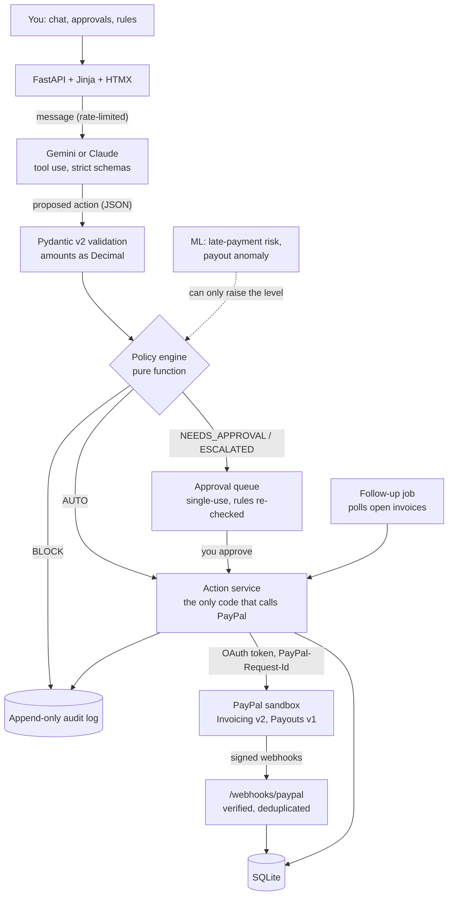

# ✈ PayPilot

**Your AI co-pilot for getting paid and paying smart.**

PayPilot turns plain-language requests into PayPal work: it creates and sends invoices, pays people through PayPal Payouts, and chases unpaid invoices with reminders that get firmer over time. You stay in charge through rules the AI cannot change. Small payments to people you already pay go through on their own; anything bigger, newer or stranger waits for you, and some things are never allowed at all.

Built for the **Build What's Next with PayPal and AI** hackathon. **PayPal sandbox only**: the PayPal base URL is locked to `api-m.sandbox.paypal.com` in code, and the UI says so on every page.

**Try it live:** [paypilot-ytst.onrender.com](https://paypilot-ytst.onrender.com) runs in labeled demo mode on the PayPal sandbox. The free instance sleeps when idle, so the first visit can take about a minute.

> **The AI proposes, the code disposes.** The language model never calls PayPal and never sees PayPal credentials. It can only return a structured action (a tool call). Pydantic validates it, a pure policy engine decides, and only then does PayPilot's own code call PayPal, or hold the action for your approval.

## Contents

- [Try it in two minutes (demo mode, no keys)](#try-it-in-two-minutes-demo-mode-no-keys)
- [What it does](#what-it-does)
- [How it works](#how-it-works)
- [APIs used](#apis-used)
- [AI tools](#ai-tools)
- [Setup with the real PayPal sandbox (under 10 minutes)](#setup-with-the-real-paypal-sandbox-under-10-minutes)
- [Demo mode](#demo-mode)
- [Deploy on Render](#deploy-on-render)
- [Why this works](#why-this-works)
- [Security](#security)
- [Project layout](#project-layout)
- [Development](#development)
- [Limitations](#limitations)
- [License](#license)

## Try it in two minutes (demo mode, no keys)

Requires Python 3.11 or newer and `make`.

```bash
git clone https://github.com/RoboDevelopX/PayPilot.git
cd PayPilot
make setup      # venv, dependencies, git pre-commit hook, .env from .env.example
make demo       # http://localhost:8000
```

`make demo` starts PayPilot in **demo mode**: sample data (a small design studio with five clients and four payees), PayPal answered from labeled recordings because no keys are set, and a scripted assistant because no AI key is set. A banner on every page says which parts are simulated, and the footer names the assistant in use. See [Demo mode](#demo-mode) for exactly what is real.

Then type these in **Chat**, in order:

| Say | What happens |
|---|---|
| `Invoice Lumen Labs $600 for launch photos` | The assistant asks for the client's email (no email, no invoice) |
| `finance@lumenlabs.example` | Invoice created and sent |
| `Pay sam@example.com $40 for the icon set` | $40 ≤ L ($50) and Sam is on the allowlist: paid automatically |
| `Pay sam@example.com $120 for the brand guide` | $120 > L: held for your approval |
| `Pay jo@example.com $160 for event photos` | Jo is new and the anomaly model flags the amount: a red **escalated** card |
| `Send a reminder to Acme Corp` | Acme always pays late, so the tone is **final**, which needs your approval |
| `Raise my auto-approve limit to $75` | Held: the assistant can never change your rules on its own |
| `Raise my auto-approve limit to $500` | Blocked: a limit can't exceed the daily cap |
| `Which invoices are overdue?` | Acme Corp and Northwind Traders |

Now open **Approvals**. Approve Sam's $120 and it goes out. Tick "I've checked this" on Jo's card and approve: it is still **blocked**, because the hard rules are re-checked at approval time and $40 + $120 + $160 is over the $200 daily cap.

<details>
<summary>Without make (Windows)</summary>

```powershell
py -3.12 -m venv .venv
.venv\Scripts\activate
pip install -r requirements-dev.txt
copy .env.example .env
$env:DEMO_MODE="1"; $env:DATABASE_URL="sqlite:///./demo.db"
uvicorn app.main:create_app --factory --port 8000
```
</details>

## What it does

1. **Chat to invoice.** "Invoice Acme Corp (ap@acme.example) $450 for logo design, due in 14 days" becomes a PayPal invoice (Invoicing v2), created and sent by PayPal. Missing details get one clarifying question instead of a guess.
2. **A policy engine you control.** Pure Python, no I/O, every rule a readable reason. Defaults, all editable on the **Rules** page:

   | Rule | Default | Effect |
   |---|---|---|
   | Auto-approve limit **L** | $50 | a ≤ L can go out alone; a > L waits for you |
   | Daily cap **D** | $200 | hard block, even with your approval |
   | Monthly cap **M** | $1,000 | hard block, even with your approval |
   | Recipient allowlist **R** | Sam, Maya, Devon (demo) | first payout to anyone else waits for you |
   | Currency allowlist **C** | USD | anything else is blocked |
   | Invoice cap | $10,000 | largest invoice the assistant may create |
   | Auto-reminders up to | firm | a "final" reminder waits for you |

3. **Guardrailed payouts** through PayPal Payouts, with a single-use approval queue. An approval re-runs the hard rules before money moves.
4. **Smart follow-ups.** A background job polls open invoices (webhooks update them too), picks a tone from days overdue (friendly 1–7, firm 8–20, final 21+), moves high-risk clients one step up the ladder, never softens, and has the AI draft the text. Paid invoices are never chased.
5. **Append-only audit trail.** Every proposal, decision, approval, PayPal call (with its `PayPal-Request-Id` and `PayPal-Debug-Id`) and webhook is recorded. SQLite triggers reject UPDATE and DELETE on the audit table.
6. **Classical ML, advisory only.** A late-payment risk model (calibrated logistic regression) and a payout anomaly detector (Isolation Forest), trained on seeded synthetic data with real held-out metrics. ML can only *raise* the approval level, never lower it. Details in [ml/MODEL_CARD.md](ml/MODEL_CARD.md) and [ml/reports/REPORT.md](ml/reports/REPORT.md).
7. **Dashboard.** Outstanding, overdue and paid this month; spend against caps; approvals waiting; clients at risk; flagged payouts; and advice such as "Acme Corp is likely to pay late; consider net-7 terms" when shorter terms would lower the estimated risk.

Multi-currency works in the narrow sense: you can allow several currencies, and caps and totals are kept per currency (no FX conversion). Per-agent budgets were a stretch goal and are not built.

## How it works



For a payout of amount *a* in currency *c* to recipient *r*, with *s_d* already paid out today and *s_m* this month:

```
BLOCK            if c ∉ C  or  s_d + a > D  or  s_m + a > M
NEEDS_APPROVAL   if r ∉ R  or  a > L
ESCALATED        if the anomaly detector flags the payout
AUTO             otherwise
```

Levels are ordered `AUTO < NEEDS_APPROVAL < ESCALATED < BLOCK` and the result is the maximum over all rules. An escalated payout shows as a red card that needs an "I've checked this" tick and can't be approved from chat. The assistant's own tools are `create_invoice`, `send_payout`, `send_reminder`, `get_status`, `ask_clarification` and `update_policy`; the last one is always held for your approval, so text injected into a chat or an invoice description can't raise its own limits.

**Why not the PayPal agent toolkit?** It hands PayPal operations to the model as tools, so the model itself makes the PayPal call. PayPilot's whole point is the opposite: the model has no PayPal tools or credentials, and a deterministic engine sits between every proposal and PayPal.

## APIs used

All calls go to the PayPal **sandbox** (`https://api-m.sandbox.paypal.com`). Endpoints and payload shapes were checked against developer.paypal.com in October 2026.

| PayPal API | Endpoint | Used for |
|---|---|---|
| OAuth 2.0 client credentials | `POST /v1/oauth2/token` | access token, cached and refreshed 60 s before expiry |
| Invoicing v2 | `POST /v2/invoicing/invoices` | create a draft invoice |
| | `POST /v2/invoicing/invoices/{id}/send` | send it to the client |
| | `GET /v2/invoicing/invoices/{id}` | status for polling and the dashboard |
| | `POST /v2/invoicing/invoices/{id}/remind` | payment reminders |
| Payouts v1 | `POST /v1/payments/payouts` | send money to an email (`sender_batch_id` = our action id) |
| | `GET /v1/payments/payouts/{batch_id}` | batch and item status |
| Webhooks | `POST /v1/notifications/verify-webhook-signature` | prove a webhook really came from PayPal |

Webhook events handled: `INVOICING.INVOICE.PAID`, `INVOICING.INVOICE.CANCELLED`, `INVOICING.INVOICE.REFUNDED`, `PAYMENT.PAYOUTSBATCH.*` and `PAYMENT.PAYOUTS-ITEM.*`.

## AI tools

- **Google Gemini** (free tier, default `gemini-3.8-flash`) or **Anthropic Claude** (default `claude-opus-5-5`), switchable with `LLM_PROVIDER` (`auto` picks Claude if its key is set, else Gemini). The model uses **tool calling** with strict JSON schemas to turn chat into one of the six actions above, and drafts reminder text in the tone the code chose. It never decides whether money moves.
- **scikit-learn**: logistic regression with sigmoid calibration for late-payment risk (compared against HistGradientBoosting and two baselines), and Isolation Forest for payout anomalies. Seed 42; `make train` reproduces the artifacts byte for byte.

## Setup with the real PayPal sandbox (under 10 minutes)

1. **PayPal sandbox app (3 min).** Sign in at [developer.paypal.com](https://developer.paypal.com), open **Apps & Credentials**, make sure the toggle says **Sandbox**, and click **Create App** (type Merchant). Copy the **Client ID** and **Secret**. In the app's features, make sure **Invoicing** and **Payouts** are ticked. If you tick a feature after the app has already asked for a token, PayPal keeps handing out the old token (without the new permission) for up to 9 hours, so calls still fail with 403 `NOT_AUTHORIZED`; `make paypal-token-reset` revokes it so the next call gets a fresh one.
2. **Sandbox accounts (1 min).** Under **Testing Tools > Sandbox Accounts** you already have a **Business** account (the merchant your app acts as) and a **Personal** account (the client who pays). Copy both emails. You can log in to [sandbox.paypal.com](https://www.sandbox.paypal.com) as the Personal account to pay invoices.
3. **AI key (2 min).** Free: get a Gemini key at [aistudio.google.com](https://aistudio.google.com) > **Get API key**. Or paid: an Anthropic key from [console.anthropic.com](https://console.anthropic.com).
4. **Configure (1 min).** `make setup` created `.env`. Fill it in locally; never paste keys into a chat, issue or commit:

   ```bash
   PAYPAL_CLIENT_ID=...
   PAYPAL_CLIENT_SECRET=...
   PAYPAL_INVOICER_EMAIL=...   # sandbox Business email
   PAYPAL_PAYER_EMAIL=...      # sandbox Personal email
   GEMINI_API_KEY=...          # or ANTHROPIC_API_KEY=...
   ```

5. **Check it (1 min).** `make smoke` runs a live end-to-end check and prints PASS or FAIL per step: OAuth, invoice create, send and remind, a $1.00 payout, a retried payout that must not pay twice, payout status, and a forged webhook that must be rejected. `make smoke ARGS=--llm` also runs one real chat turn, with nothing executed.
6. **Run it.** `make run` and open http://localhost:8000. The footer shows the AI provider and model; `/healthz` reports `"paypal": "sandbox"`.

## Demo mode

`DEMO_MODE=1` (what `make demo` and the Render blueprint set) does three things, and labels each one:

| | Real sandbox path (default) | Demo mode |
|---|---|---|
| Data | empty database | sample data seeded on boot, marked "sample data" everywhere |
| PayPal | live sandbox | live sandbox if keys are set; if it is unreachable or erroring after retries, or no keys are set, the call is answered from [recorded responses](app/paypal/recorded/) |
| AI | your key, or chat is off | your key; if there's no key or the model fails, a scripted assistant that knows the demo phrasings and starts every reply with "Demo script (no AI model):" |

Simulated PayPal answers carry a `PayPal-Debug-Id` starting with `demo-recorded-` and ids like `INV2-DEMO-…` or `DEMO-BATCH-…`, so the audit log shows exactly which steps never touched PayPal. A webhook can never be verified from a recording. Validation errors from the live sandbox are never papered over. With `DEMO_MODE=0` (the default) none of this is wired in.

## Deploy on Render

1. Push the repo to GitHub. In Render, choose **New > Blueprint** and pick the repo; [render.yaml](render.yaml) defines one free web service.
2. Render asks for each secret. Leave any you don't have blank: with none at all you get a fully labeled demo. Set **APP_PASSWORD** to put the site behind HTTP Basic auth (user `paypilot`); `/healthz`, `/webhooks/paypal` and `/static` stay open.
3. Open `https://<your-service>.onrender.com/healthz` to see which parts are live.
4. **Webhooks (optional, 2 min).** In your sandbox app on developer.paypal.com, under **Webhooks**, add `https://<your-service>.onrender.com/webhooks/paypal` with the events `INVOICING.INVOICE.PAID`, `INVOICING.INVOICE.CANCELLED`, `INVOICING.INVOICE.REFUNDED`, `PAYMENT.PAYOUTSBATCH.SUCCESS`, `PAYMENT.PAYOUTSBATCH.DENIED` and the `PAYMENT.PAYOUTS-ITEM.*` events. Copy the **Webhook ID**, add it on the Render service's **Environment** page as a new variable `PAYPAL_WEBHOOK_ID` (Render doesn't create variables you left blank), and redeploy. Test it with a real invoice payment: the dashboard's webhook simulator sends events PayPal won't verify. Without webhooks, the follow-up job still polls open invoices.

The free plan sleeps after about 15 idle minutes and wipes its disk on every deploy, so the SQLite database starts empty and demo data is reseeded on boot. The chat is rate-limited per IP (20 messages a minute) so a public demo can't burn through an AI quota.

## Why this works

Short notes on the parts that are easy to get wrong. Longer versions sit at the top of the files named.

- **Money** ([app/money.py](app/money.py)). Floats are binary fractions, so 0.1 + 0.2 ≠ 0.3. PayPal exchanges amounts as decimal strings like `"450.00"`; PayPilot keeps them as `Decimal` end to end and stores cents, so what you typed is exactly what PayPal sees.
- **OAuth 2.0 client credentials** ([app/paypal/client.py](app/paypal/client.py)). The app sends its client id and secret to `/v1/oauth2/token` and gets a short-lived bearer token. Caching it until 60 s before expiry means most calls cost one request, not two.
- **Idempotency** ([app/services/actions.py](app/services/actions.py)). Each action is saved before PayPal is called, and its id derives the `PayPal-Request-Id` for every step (and the payout's `sender_batch_id`). If the network drops after PayPal acted, a retry with the same id returns the original result instead of paying or billing twice. `make smoke` checks this live.
- **Webhooks** ([app/paypal/webhooks.py](app/paypal/webhooks.py)). Anyone can POST to a public URL, so PayPilot asks PayPal to verify each delivery's signature against its webhook id, stores each event id once (PayPal retries), and still polls, because webhooks can be missed.
- **FastAPI** ([app/main.py](app/main.py)). `create_app()` builds the app from a `Settings` object, so tests get an isolated app with an in-memory database and a fake PayPal transport, while Uvicorn runs the real configuration with `--factory`.
- **Render** ([render.yaml](render.yaml)). Render runs the build command, starts Uvicorn on `$PORT`, and only routes traffic to a new deploy once `/healthz` returns 200.

## Security

- Secrets live only in environment variables (`.env` locally, Render's secret store in production) and are `SecretStr`, so they never appear in logs or tracebacks. A pre-commit hook and CI run [scripts/check_secrets.py](scripts/check_secrets.py) to keep keys out of the repo.
- Sandbox only: `PAYPAL_BASE_URL` refuses anything but the sandbox host.
- User text and invoice descriptions are treated as untrusted. The model has no PayPal access and no tool that changes rules without your approval, and the policy engine always has the final say.
- Approvals are single-use (an atomic database update) and re-check the hard rules.
- The chat endpoint is rate-limited per client IP, keyed on the address Render's proxy saw, so a spoofed `X-Forwarded-For` doesn't help.

## Project layout

| Path | What's there |
|---|---|
| `app/agent/` | tool definitions, the tool-use loop (Claude and Gemini), the demo-mode script |
| `app/policy/engine.py` | the pure policy engine |
| `app/services/` | actions (the only PayPal caller), approvals, follow-ups, webhooks, audit, ML scoring, dashboard, demo seed |
| `app/paypal/` | typed PayPal client, Invoicing, Payouts, webhook verification, demo recordings |
| `app/routers/`, `app/templates/`, `app/static/` | JSON API, HTMX pages, CSS and vendored htmx |
| `ml/` | synthetic data generator, shared features, training, evaluation, model card, artifacts |
| `prompts/` | system prompt and reminder prompt |
| `scripts/` | live smoke test, M1 invoice proof, seed, secret check |
| `tests/` | about 200 tests; PayPal is faked with respx, live tests skip without keys |

## Development

| Command | Does |
|---|---|
| `make setup` | venv, dependencies, pre-commit hook, `.env` |
| `make run` | the app with your `.env` (real sandbox path) |
| `make demo` | the app in demo mode, on a separate `demo.db` |
| `make test` | the test suite |
| `make lint` | ruff, black, secret check |
| `make train` | regenerate synthetic data, retrain both models, rewrite the ML report |
| `make seed` | load the sample data into the configured database without demo mode |
| `make smoke` | live sandbox end-to-end check (`ARGS="--llm --record"` for more) |

## Limitations

- Sandbox only, single user, single process. SQLite is fine for a demo; a real deployment would want Postgres and a proper job queue.
- The ML models are trained on synthetic data. Their metrics show the pipeline is sound and honestly evaluated, not that they predict real customers. The risk model only slightly beats "this client's past late rate" (ROC-AUC 0.756 vs 0.748), and the anomaly detector catches 2 of 6 burst anomalies in the test window.
- In the demo recordings, `invoice.json` and `payout_get.json` are real sandbox captures; `payout_create.json` was written from the Payouts docs. `make smoke ARGS=--record` re-captures them from your own sandbox.
- Reminders use PayPal's remind endpoint, so the email itself comes from PayPal.

## License

[MIT](LICENSE)
