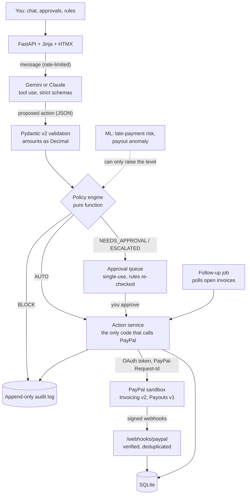

# PayPilot: submission overview

**Your AI co-pilot for getting paid and paying smart.** An AI agent that creates and sends PayPal invoices from chat, pays people through PayPal Payouts within rules you set, and chases late payers in a tone that fits how late they are and how they usually pay.

> **The AI proposes, the code disposes.** The language model never calls PayPal and has no PayPal credentials. It returns a structured action; Pydantic validates it; a pure, unit-tested policy engine decides; and only then does PayPilot's code call PayPal, or hold the action for your approval.

Everything runs against the **PayPal sandbox**. The base URL is locked to the sandbox in code, and every page says SANDBOX.

**Live app:** [paypilot-ytst.onrender.com](https://paypilot-ytst.onrender.com) (demo mode on the sandbox; the free instance can take about a minute to wake).

| Look at | Where |
|---|---|
| Full README (setup, deploy, design notes) | [../README.md](../README.md) |
| Policy engine | [app/policy/engine.py](../app/policy/engine.py) |
| The only code that calls PayPal | [app/services/actions.py](../app/services/actions.py) |
| ML model card and held-out metrics | [ml/MODEL_CARD.md](../ml/MODEL_CARD.md), [ml/reports/REPORT.md](../ml/reports/REPORT.md) |
| Devpost text | [DEVPOST.md](DEVPOST.md) |
| 2:30 demo shot list | [DEMO_SCRIPT.md](DEMO_SCRIPT.md) |
| Requirements checklist | [CHECKLIST.md](CHECKLIST.md) |

## Architecture



The approval rule, for a payout of amount *a* in currency *c* to recipient *r*, with *s_d* paid out today and *s_m* this month:

```
BLOCK            if c ∉ C  or  s_d + a > D  or  s_m + a > M
NEEDS_APPROVAL   if r ∉ R  or  a > L
ESCALATED        if the anomaly detector flags the payout
AUTO             otherwise
```

The result is the maximum level over all rules. ML can add ESCALATED but can never lower a level or unblock anything. Changes to the rules proposed in chat always wait for the user.

## APIs used

| PayPal API (sandbox) | Used for |
|---|---|
| OAuth 2.0 client credentials (`/v1/oauth2/token`) | access tokens, cached |
| Invoicing v2: create, send, get, remind | invoices from chat, status polling, reminders |
| Payouts v1: create, get | guardrailed payouts (`sender_batch_id` = action id) |
| Webhooks: verify signature | trusting invoice-paid and payout-status events |

Every create call carries a deterministic `PayPal-Request-Id`, so a retry can't bill or pay twice.

## AI tools

- **Google Gemini** (free tier) or **Anthropic Claude**, switchable with one setting, using tool calling with strict schemas for six actions (`create_invoice`, `send_payout`, `send_reminder`, `get_status`, `ask_clarification`, `update_policy`) and drafting reminder text.
- **scikit-learn**: a calibrated logistic-regression late-payment risk model and an Isolation Forest payout anomaly detector, trained on seeded **synthetic** data with honest held-out metrics (risk ROC-AUC 0.756 against 0.748 for the client's past late rate alone; anomaly precision 0.63 and recall 0.81 at a 3% review budget).

## Run it

No keys, about two minutes (Python 3.11+):

```bash
git clone https://github.com/RoboDevelopX/PayPilot.git && cd PayPilot
make setup && make demo     # http://localhost:8000
```

With the real sandbox, under ten minutes: create a sandbox app at developer.paypal.com (Invoicing and Payouts enabled), get a free Gemini key at aistudio.google.com, fill in `.env`, then `make smoke` (live PASS/FAIL check) and `make run`. Step-by-step instructions are in the [main README](../README.md#setup-with-the-real-paypal-sandbox-under-10-minutes).

## Demo mode

`DEMO_MODE=1` seeds sample data (marked as sample data everywhere), answers PayPal calls from recorded responses only when the live sandbox is unreachable or no keys are set, and uses a scripted assistant when there's no AI key. A banner on every page says which parts are simulated; simulated PayPal answers carry `demo-recorded-` debug ids in the audit log. The real sandbox path is the default (`DEMO_MODE=0`).

## License

[MIT](../LICENSE)
